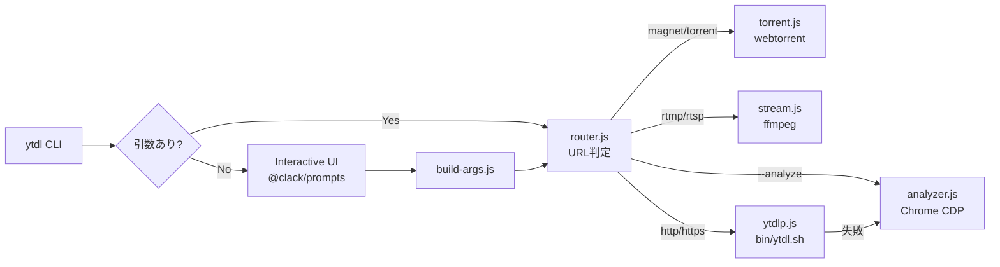
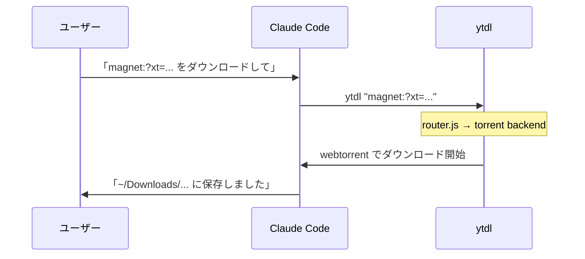

[](https://github.com/kanketsu-jp/ytdl)

## TL;DR

:::message
**あらゆるメディアをサクッと取得したい**

→ **`ytdl` という CLI を作った。動画サイト だけでなく、Torrent（P2P）、RTMP/RTSP ストリームにも対応。URL を渡すだけでバックエンドが自動選択される**

1. `npm install -g @kanketsu/ytdl` でインストール
2. `ytdl "URL"` で一発実行。http なら yt-dlp、magnet なら Torrent、rtmp なら ffmpeg が自動起動
3. `ytdl` だけ打てばインタラクティブ UI が起動。選ぶだけ
4. Claude Code のプラグインとして「この動画ダウンロードして」と言うだけでも使える
5. 7 言語対応（ja / en / zh-Hans / es / hi / pt / id）
6. **v1.4**: 落とした動画をそのまま文字起こし。話者分離・字幕・「ここ」と言っている場面の静止画まで出る
---
#### **リポジトリ:** [kanketsu-jp/ytdl](https://github.com/kanketsu-jp/ytdl)
:::

@[tweet](https://x.com/kazuma_horiike/status/2025922814105334148?s=20)


## なぜ作ったか

動画をローカルに保存したい場面はけっこうある。オフラインで見たい、素材として使いたい、アーカイブしておきたい。

技術者なら yt-dlp を使うのが定番だけど、毎回こうなる。

```bash
yt-dlp --write-thumbnail --convert-thumbnails jpg \
  --write-subs --write-auto-subs --sub-langs ja,ja-orig \
  --write-description \
  -f "bestvideo+bestaudio/best" \
  --merge-output-format mp4 \
  -o "%(channel)s/%(title)s/%(title)s.%(ext)s" \
  "https://example.com/watch?v=VIDEO_ID"
```

覚えられるわけがない。

さらに、動画サイト 以外からも取得したいケースがある。Torrent で配布されているアーカイブ、RTMP で流れているライブ配信、普通のサイトに埋め込まれた動画……それぞれ別のツールが必要で、コマンドも全然違う。

> じゃあもう、URL を渡したらバックエンドを自動選択して全部やってくれるツールを作ればいいのでは？

そう思って作ったのが ytdl v2.0 です。

## インストール

```bash
npm install -g @kanketsu/ytdl
```

グローバルインストールせずに試したい場合は `npx` でも実行できます。

```bash
npx @kanketsu/ytdl "URL"
```

yt-dlp と ffmpeg が必要ですが、初回実行時になければ自動でインストールを提案してくれます。

:::message
**前提:** yt-dlp と ffmpeg が必要です。手動で入れる場合は `brew install yt-dlp ffmpeg` を実行してください。
:::

## 基本的な使い方

### 一番かんたん：引数なしで実行

```bash
ytdl
```

インタラクティブ UI が起動します。URL を貼って、あとはポチポチ選ぶだけ。

```
◆  ytdl
│
◆  URL
│  https://example.com/watch?v=VIDEO_ID
│
◆  何をダウンロードしますか？
│  ● 動画（最高画質, mp4）
│  ○ 音声のみ（m4a）
│  ○ 情報のみ表示（ダウンロードしない）
│
◆  画質
│  ● 最高画質（おすすめ）
│  ○ 4K (2160p)
│  ○ 1080p
│  ○ 720p
│
◆  保存先
│  ~/Downloads
│
◇  ダウンロードを開始しますか？
│  はい
```

### URL を渡すだけで自動判定

ytdl は URL のプロトコルやパターンを見て、バックエンドを自動選択します。

```bash
# 動画サイト（yt-dlp バックエンド）
ytdl "https://example.com/watch?v=VIDEO_ID"

# マグネットリンク（Torrent バックエンド）
ytdl "magnet:?xt=urn:btih:..."

# RTMP ライブ配信（ffmpeg バックエンド）
ytdl "rtmp://live.example.com/stream/key"

# .torrent URL（Torrent バックエンド）
ytdl "https://example.com/file.torrent"
```

### 各バックエンドの使い方

```bash
# yt-dlp（動画サイト、1000以上対応）
ytdl "URL"                      # 最高画質
ytdl -a "URL"                   # 音声のみ (m4a)
ytdl -q 720 "URL"               # 720p 制限
ytdl -p "playlist URL"          # プレイリスト一括

# Torrent（P2P）
ytdl "magnet:?xt=urn:btih:..."
ytdl "https://example.com/file.torrent"

# ストリーム録画（RTMP/RTSP）
ytdl "rtmp://..."               # 停止まで録画
ytdl --duration 3600 "rtmp://..." # 1時間録画
ytdl "rtsp://camera.example.com/feed"

# サイト解析（yt-dlp で取れない場合）
ytdl --analyze "https://example.com/page-with-video"

# バックエンドを明示指定
ytdl --via torrent "magnet:?xt=..."
ytdl --via stream "rtmp://..."
```

## オプション一覧

| フラグ | 説明 | デフォルト |
|------|------|---------|
| `-a` | 音声のみ（m4a） | off |
| `-q <解像度>` | 画質指定（360/480/720/1080/1440/2160） | 最高画質 |
| `-o <ディレクトリ>` | 保存先 | `~/Downloads` |
| `-p` | プレイリストモード | off |
| `-b <ブラウザ>` | クッキー取得元ブラウザ | off |
| `-n` | クッキーなし（デフォルト） | on |
| `-i` | 情報のみ表示 | off |
| `-t` | 文字起こし | off |
| `--backend <b>` | 文字起こしバックエンド (local/api) | local |
| `--manuscript <path>` | 原稿ファイルパス（精度向上） | - |
| `--lang <code>` | 表示言語（ja/en/zh-Hans/es/hi/pt/id） | ja |
| `--via <backend>` | バックエンド指定（ytdlp/torrent/stream/analyzer） | 自動 |
| `--analyze` | サイト解析モードを強制 | off |
| `--duration <秒>` | ストリーム録画時間（秒） | 停止まで |
| `--` | 以降を yt-dlp に直接渡す | - |

## もうちょっと深掘ってみた

ここからは、ytdl v2.0 の内部構造と設計について掘り下げていきます。

### アーキテクチャ

v2.0 で最大の変更点は **URL ルーターとマルチバックエンド構成**です。



v1.x では Node.js → bash の一本道でしたが、v2.0 では `lib/router.js` が URL を見てバックエンドを振り分けます。各バックエンドは `lib/backends/` 配下の独立したモジュールです。

**重要な設計判断：** `bin/ytdl.sh` は一切変更しない。yt-dlp バックエンド（`lib/backends/ytdlp.js`）が ytdl.sh をそのままラップする形にしました。既存の動作を完全に保ちつつ、新機能を追加できます。

### URL ルーティングの仕組み

```javascript
// lib/router.js（抜粋）
export function routeUrl(url) {
  if (url.startsWith('magnet:')) return { backend: 'torrent', reason: 'magnet URI' }
  if (/\.torrent(\?.*)?$/.test(url)) return { backend: 'torrent', reason: '.torrent URL' }

  const protocol = new URL(url).protocol
  if (['rtmp:', 'rtsp:'].includes(protocol)) return { backend: 'stream', reason: `${protocol} stream` }
  if (['http:', 'https:'].includes(protocol)) return { backend: 'ytdlp', reason: 'http/https URL' }

  return { backend: 'ytdlp', reason: 'fallback' }
}
```

シンプルなパターンマッチング。URL のプロトコルとパターンだけで判定します。

### Torrent バックエンド

[webtorrent](https://github.com/webtorrent/webtorrent) を使った P2P ダウンロードです。webtorrent は optionalDependencies なので、必要なときだけインストールされます。

```javascript
// lib/backends/torrent.js（概略）
import { createRequire } from 'module'
const require = createRequire(import.meta.url)

// webtorrent が未インストールの場合はインストールを促す
let WebTorrent
try {
  WebTorrent = require('webtorrent')
} catch {
  // ユーザーに「インストールしますか？」を提示
}
```

### ストリーム録画バックエンド

ffmpeg を `spawn` で直接呼び出してストリームを録画します。`--duration` で録画時間を指定できます。

```bash
# 内部的には ffmpeg が呼ばれる
ffmpeg -i rtmp://... -c copy output.mp4
```

### サイト解析バックエンド

Chrome DevTools Protocol (CDP) でページを開き、ネットワークリクエストの監視 + DOM から `<video>` タグや OGP タグを探します。Puppeteer を使わず、`ws` パッケージだけで Chrome を直接制御する軽量アプローチです。ログイン付きダウンロードにも対応し、永続 Chrome プロファイル（`~/.ytdl/chrome-profile/`）でセッションを保持できます。yt-dlp が失敗したときの自動フォールバックにもなります。

### セキュリティ

v1 から引き続き、コマンドインジェクション対策を徹底しています。

```javascript
// ✅ 安全: 配列で引数を渡す（shell 展開なし）
spawn("bash", [SCRIPT, ...args], { stdio: "inherit" });

// ❌ 危険（ytdl ではやっていない）
exec(`bash ${SCRIPT} ${args.join(" ")}`);
```

Torrent バックエンドも同様に、マグネットリンクをそのまま webtorrent API に渡すだけで、シェルには渡しません。

### npm パッケージとしての構成

```json
{
  "name": "@kanketsu/ytdl",
  "version": "2.0.0",
  "dependencies": {
    "@clack/prompts": "^1.0.1",
    "picocolors": "^1.1.1"
  },
  "optionalDependencies": {
    "webtorrent": "^2.5.0",
    "ws": "^8.19.0"
  }
}
```

webtorrent と ws（サイト解析用 WebSocket クライアント）は optionalDependencies に。普段は不要、使うときだけインストールされます。

## Claude Code プラグインとして使う

v2.0 でプラグインの機能も強化されました。マグネットリンクや RTMP URL を貼っても Claude が適切に処理してくれます。



URL の種別を Claude が判断する必要はありません。ytdl が自動で振り分けます。

### インストール

Claude Code で以下を実行。

```
/plugin marketplace add kanketsu-jp/ytdl
/plugin install ytdl@kanketsu-ytdl
```

## 【v1.4】落とした動画を「誰が・いつ・何を話したか」まで起こす

v1.4 で `transcribe-scenes` というスキルを足した。**ダウンロードの次にやりたくなること**——文字起こし——を、そのまま同じツールの中で完結させる。

出るものはこれ。

```
<出力先>/<動画名>/
  transcript.json    構造化データ（最終成果物）
  transcript.md      読み物
  subtitles.srt      字幕
  subtitles.vtt      字幕
  speakers.json      話者ごとの発話量
  images/            「ここ」「これ」と言っている場面の静止画
  logs/              工程ごとの生データ（やり直し・検証用）
```

### いちばん言いたいこと：固有名詞をプロンプトに入れるだけでは精度は上がらない

Whisper には `initial_prompt` がある。固有名詞を先に渡しておくと聞き取りのヒントになる、というやつだ。これを「入れれば良くなる」と思っていた。**実際に測ったら違った。**

同じ動画（57秒の選挙用スポット）で 3 回まわした結果。

| 条件 | 出力 |
|---|---|
| プロンプト無し | 大阪**一新のカイド三好香織**です／新しい**カタノ**へ |
| 固有名詞プロンプト有り | 大阪**維新の会の三好薫**です／新しい**刀**へ |
| ＋ 置換規則 | 大阪維新の会の三好薫です／新しい**交野**へ ✅ |

:::message alert
プロンプトを入れたことで「大阪一新のカイド」→「大阪維新の会の」は直った。**その代わり「カタノ」が「刀」になった。**

固有名詞を渡すと、モデルはその語彙に引っ張られる。**引っ張られて直る語と、引っ張られて壊れる語が同時に出る。**
:::

だから工程を 2 つに分けた。

- **`initial_prompt`** … 聞き取りのヒント（前もって渡す）
- **`normalize`** … 出てきた誤りの直し（後から当てる）

`normalize` は置換規則の JSON を受け取り、**どの規則が何件効いたか**を `logs/08_normalize.json` に残す。

```json
{ "rules": [
  { "right": "交野", "wrong": ["刀", "片野", "カタノ"], "note": "実際に出た誤りだけ" }
] }
```

:::message
**規則は 1 回目の出力を読んでから作る。**「起きそうだから」で足すと誤爆する。たとえば「府政 ← 不正」は、本当に「不正」と出た動画でだけ有効にすべきで、先回りで入れると普通の「不正」まで書き換えてしまう。
:::

### 話者分離は pyannote を使わなかった

「誰が話しているか」を分ける定番は [pyannote.audio](https://github.com/pyannote/pyannote-audio) だが、Hugging Face の gated モデルで、利用同意とトークンが要る。**「入れたらすぐ動く」を壊したくなかった**ので、こうした。

1. VAD（`webrtcvad`、無ければエネルギーベース）で発話区間を切る
2. [Resemblyzer](https://github.com/resemble-ai/Resemblyzer) の `VoiceEncoder` で各区間の d-vector を取る
3. `AgglomerativeClustering`（cosine / average）でまとめる
4. 人数未指定なら**シルエット係数**でクラスタ数 2〜6 を試して最良を選ぶ

精度は「だいたい」。ただし話者分離だけを独立した工程にしてあるので、**あとで pyannote に差し替えても他の工程は作り直しにならない。**

### 「1人でした」と「測っていません」を区別する

ここは意識して作った。`logs/03_diarization.json` はこう出る。

```json
{
  "method": "resemblyzer+agglomerative",
  "n_speakers": 1,
  "chose_by": "speech_turn_count",
  "silhouette": null,
  "evidence": {
    "vad_method": "webrtcvad",
    "turn_count": 2,
    "reason": "発話区間が3未満のためクラスタリングしていない",
    "measured": false
  }
}
```

`n_speakers: 1` だけ見ると「1人の動画だった」と読める。でも実際は**発話区間が少なすぎてクラスタリングを走らせていない**。この 2 つは結果が同じ顔で出るので、`measured` で分けている。

シーン抽出も同じ。0 件のとき、理由と**何件調べたか**を書く。

```json
{ "scenes": [], "reason": "指示語に一致するセグメントが無い",
  "checked_segments": 14, "deictic_terms": ["ここ","それ","この", ...] }
```

:::message
**「0 件」は、それだけでは情報を持たない。**「無かった 0」と「見ていない 0」が同じ見た目になるから、出力側で区別できるようにしておく。
:::

### 「ここ」「これ」と言っている場面を画像にする

喋りの文字起こしで困るのが指示語だ。「**ここ**が課題で」「**これ**を見てください」——文字だけ読んでも何のことか分からない。

そこで、指示語を含むセグメントの中央時刻で `ffmpeg` から静止画を抜く。

```bash
ffmpeg -ss <t> -i <video> -frames:v 1 -q:v 2 images/scene_001_0009.jpg
```

拾いすぎる側に倒してある（「この街」のような、画面を指していない用法も拾う）。**取りこぼすと気づけないが、過検出は人が 1 枚見て捨てるだけで済む**からだ。

### 副作用：プロンプトを渡すとセグメントが長くなる

これも測って初めて気づいた。`initial_prompt` を渡すと、**Whisper のセグメント分割が粗くなる。**

| | セグメント数（57秒） | シーン抽出 |
|---|---|---|
| プロンプト無し | 14 | 3 件 |
| プロンプト有り | 4 | **1 件** |

1 つの長い塊に「この」も「その」も入ってしまい、1 件に統合される。**文字の正確さを上げると、時刻の細かさが落ちる。**

字幕やシーン抽出のように「いつ」が要る用途では、**1 回目（プロンプト無し）の時刻を使う**という選択肢がある。ここはまだ自動で切り替えていない。

### ついでに踏んだバグ

`scenes` を条件を変えて回し直したら、`images/` に**前回の画像が残った**。

```
images/ の実ファイル   4 枚
07_scenes.json の件数  1 件
```

ディレクトリを見た人は「4 シーンあった」と読む。JSON を見た人は「1 件」と読む。**どちらも間違っていないのに食い違う**、いちばん厄介なタイプだ。書き出し前に古い画像を消すようにして、**シーンがある場合と 0 件の場合の両方で件数が一致すること**を確かめた。

### 機械に実名を当てさせない

`transcript.json` の `speaker_label` は、**このスクリプトからは必ず `null` で出る。**

声で分けられるのは「人物A / 人物B」までで、それが誰かは**本文の内容**からしか分からない。自己紹介、司会が名前を呼ぶ、その人しか言えない内容——これを読んで当てるのは人か AI の仕事だ。

:::message alert
確信が持てないものは `null` のまま残す。埋めた方が見た目は良くなるが、**間違った名前が付いた記録は、無い記録より害がある。**
:::

### 使い方

```bash
# 通し
python3 skills/transcribe-scenes/scripts/pipeline.py run \
  --url "https://youtu.be/xxxxxxxxxxx" --outdir ./out \
  --prompt-file nouns.txt --rules rules.json --speakers 4
```

工程ごとに単独でも回せる。1 回目を読んでから規則を作る、という流れがあるので、実際はこちらの方が多い。

```bash
P=skills/transcribe-scenes/scripts/pipeline.py
python3 $P fetch      --url <URL> --outdir ./out
python3 $P transcribe --outdir ./out --name <NAME> --pass 1 --prompt-file nouns.txt
python3 $P diarize    --outdir ./out --name <NAME>
#  ← ここで 1 回目を読んで rules.json を作る
python3 $P transcribe --outdir ./out --name <NAME> --pass 2 --prompt-file nouns.txt
python3 $P normalize  --outdir ./out --name <NAME> --rules rules.json
python3 $P align      --outdir ./out --name <NAME>
python3 $P scenes     --outdir ./out --name <NAME>
python3 $P emit       --outdir ./out --name <NAME>
```

Claude Code から使うなら、スキルが勝手に立ち上がるので日本語で言えばいい。

```
transcribe-scenes のスキルで、この動画を文字起こしして。
https://youtu.be/xxxxxxxxxxx

固有名詞は、イベントのチラシと本人のサイトから先に集めて。
1回目の結果を読んでから置換規則を作って、2回目を回して。
話者は声で分けたあと、本文の内容から誰かを当てて。分からないものは空のままにして。
```

### 必要なもの

```bash
pip install -r skills/transcribe-scenes/scripts/requirements.txt
```

`ffmpeg` / `yt-dlp` は ytdl 本体と同じものを使う。文字起こしは Apple Silicon なら `mlx-whisper`（`large-v3-turbo`）がローカルで走るので、**音声を外に出さずに完結する。** 選挙・医療・社内会議など、外部 API に上げたくない素材でも使える。

## まとめ

:::message
**最重要ポイント:**
1. `npm install -g @kanketsu/ytdl` → `ytdl "URL"` で完了
2. 動画サイト も Torrent も RTMP も、URL を渡すだけでバックエンドが自動選択
3. 7 言語対応（`--lang` で切替）
4. Claude Code プラグインとして、AI に「ダウンロードして」と言うだけでも使える
5. v1.4 で `transcribe-scenes` を追加。落とした動画を話者つき文字起こし・字幕・シーン画像まで一気に起こせる（全部ローカル）
:::

## 実際に試してみよう

```bash
# インストール
npm install -g @kanketsu/ytdl

# 動画サイト 動画
ytdl "https://example.com/watch?v=VIDEO_ID"

# インタラクティブモード
ytdl

# 英語で試す
ytdl --lang en
```

Claude Code ユーザーなら、プラグインも試してみてください。

```
/plugin marketplace add kanketsu-jp/ytdl
/plugin install ytdl@kanketsu-ytdl
```

あとは動画の URL（動画サイト でも Torrent でも）を貼って「ダウンロードして」と言うだけです。

## ※動画ダウンロードについて

:::message
動画のダウンロードは、対象サイトの利用規約や著作権法に抵触する場合があります。本ツールは yt-dlp のコマンド操作を AI 経由で簡単にすることを目的としたラッパーであり、違法なダウンロードを推奨・助長するものではありません。利用にあたっては、対象コンテンツの権利者が定める規約を確認し、自己責任のもとでご使用ください。
:::

## 参考文献

[^1]: [ytdl skills/download/SKILL.md — Security セクション](https://github.com/kanketsu-jp/ytdl/blob/main/skills/download/SKILL.md)

- [yt-dlp 公式リポジトリ](https://github.com/yt-dlp/yt-dlp)
- [webtorrent](https://github.com/webtorrent/webtorrent)
- [@clack/prompts](https://www.clack.cc/)
- [Claude Code プラグインドキュメント](https://code.claude.com/docs/ja/plugins)
- [ytdl リポジトリ](https://github.com/kanketsu-jp/ytdl)
